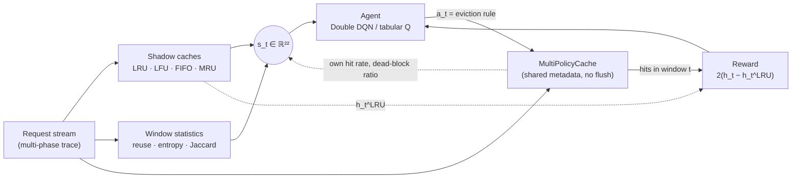
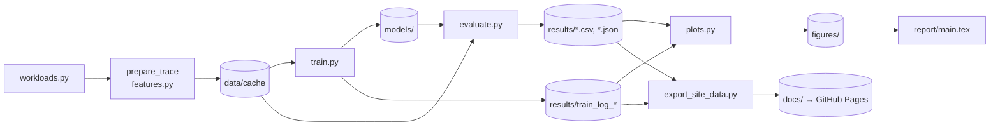

# Adaptive Cache Replacement Under Changing Workloads via Reinforcement Learning

**Team:** Lakshya Jain (B23CS1032) · Ripu Daman Singh (B23CS1057), Dept. of CSE, IIT Jodhpur
**Repository:** <https://github.com/Damanish/adaptive_cache_replacement_rl>
**Report:** [`report/main.pdf`](report/main.pdf) (2 pages, references included) ·
**Interactive results:** <https://damanish.github.io/adaptive_cache_replacement_rl/> ·
**Docs:** [Architecture & developer guide](docs/ARCHITECTURE.md)

No single cache eviction policy is best for every access pattern. LRU collapses on sequential
scans and on loops larger than the cache. LFU holds on to blocks that were popular in an earlier
phase. This project trains an RL agent that, every `W = 100` requests, chooses **which eviction
rule** (LRU, LFU, FIFO, optionally MRU) the cache uses next, based only on statistics of past
requests.

On 20 held-out multi-phase traces, Double DQN beats every non-clairvoyant baseline, including
ARC. With MRU available, it reaches **63.6% hit rate** versus 57.1% for ARC and 68.6% for Belady's
offline optimum.



---

## 1. RL formulation

An episode is one trace. Step `t` covers requests `[tW, (t+1)W)`. Each action is a macro-action
that lasts `W` requests, which makes the problem a semi-MDP over windows.

### 1.1 State space 𝒮 ⊂ ℝ²²

The state is computed only from windows before `t`; `tests/test_cache_rl.py::test_features_are_causal`
checks that no future requests leak in. It has the same 22-dimensional layout for the 3- and 4-action
settings.

| Group | Dims | Features |
| :--- | :---: | :--- |
| Shadow caches | 8 | Last-window hit rate of fixed LRU / LFU / FIFO / MRU caches run on the same stream, plus their EMA (β = 0.8) |
| Stream statistics | 7 | Unique-key ratio · sequential-stride ratio `P[k_i = k_{i−1}+1]` · first-reference ratio · reuse-interval buckets `Δ ≤ C`, `C < Δ ≤ 4C` · normalised popularity entropy `−Σ p ln p / ln W` · key-set Jaccard overlap with the previous window |
| Agent state | 7 | Own hit rate and its EMA · fraction of resident blocks never re-referenced · one-hot previous action (4 slots) |

The full index table is in [docs/ARCHITECTURE.md §5](docs/ARCHITECTURE.md#5-observation-layout).

### 1.2 Action space 𝒜 (discrete)

* **3-action setting (proposed):** `{0: LRU, 1: LFU, 2: FIFO}`
* **4-action setting (extension):** adds `3: MRU`

The action sets the victim rule for every miss in the next window.

### 1.3 Reward ℛ

Raw hit rate depends heavily on the phase: Belady's optimum reaches 0.29 on scans but 0.83 on
drift. That swing inflates the variance of TD targets. The default reward is therefore relative to
a shadow LRU cache that sees the same window:

$$r_t = 2\,(h_t - h^{\text{LRU}}_t) - \lambda\,\mathbf{1}[a_t \neq a_{t-1}], \qquad \lambda = 0 \text{ in all experiments.}$$

The request stream is exogenous, so `h^LRU_t` does not depend on the agent's actions. Subtracting
it shifts every action value of a state by the same amount and leaves the greedy policy unchanged.
Two alternatives are also implemented (`--reward`): hit/miss `2h_t − 1`, and latency
`−(h_t·L_hit + (1−h_t)·L_miss)/L_miss` with `L_hit = 1`, `L_miss = 100`.

### 1.4 Environment

`MultiPolicyCache` stores, for every slot, the last-access time (LRU/MRU), the insertion time (FIFO)
and an exponentially aged frequency `f ← f·2^{−(t−t_last)/H} + 1` with `H = 10C` (LFU). Switching
policy changes only the victim rule; the cache is never flushed. Aging stops LFU from keeping blocks
that were hot in an earlier phase.

### 1.5 Algorithms

| | Tabular Q-learning | Double DQN |
| --- | --- | --- |
| State | Discretised: best shadow policy × margin × own-hit-rate bin × previous action × Jaccard flag (216 / 384 states) | Raw 22-dim vector |
| Model | Q-table, α = 0.1 | MLP 22 → 128 → 128 → \|𝒜\|, Huber loss, Adam 5e-4, replay 50k, Polyak τ = 0.01 |
| Training | 300 episodes (≈ 99k steps) | 150 episodes (≈ 49k steps) |
| Common | γ = 0.9; ε linear 1 → 0.03 over 60% of training; reward × 10; best checkpoint on 8 validation traces | |

### 1.6 Baselines

Fixed LRU / LFU / FIFO / MRU · Random · **FTL** (use the last window's best shadow policy: the
same information as the agent, without learning) · **Phase-Oracle** (best *single* fixed policy for
each true phase, chosen in hindsight; not an upper bound on switching policies) · **ARC**
(Megiddo & Modha, 2003) · **Belady's MIN** (offline optimum).

## 2. Workloads

Each trace concatenates 6 phases of 3,000–8,000 requests, drawn at random from five regimes. Each
phase uses its own key range, and no regime repeats twice in a row.

| Regime | Generator | Policy it favours |
| --- | --- | --- |
| `zipf` | Zipf popularity, α ∈ [0.9, 1.2], universe 20C | Frequency (LFU) |
| `drift` | Hot set of 0.6–0.9C blocks that moves to fresh keys every 3–6C requests | Recency (LRU) |
| `scan` | Hot set of 0.5–0.7C blocks interleaved with one-shot sequential runs | Scan-resistant (aged LFU) |
| `stack` | LRU stack-distance model, reuse probability 0.75–0.9 | Recency (LRU) |
| `loop` | Cyclic sweep over 1.1–1.5C blocks, plus a small hot set (30% of requests) | MRU after warm-up |

The splits use disjoint seeds: train 0–63 (64 traces), validation 500–507 (8), test 1000–1019 (20).
Three hand-crafted scenarios (`zipf_scan_drift`, `drift_loop_stack`, `fast_switch`) are used for the
timeline plots.

## 3. Installation and reproduction

Requires Python ≥ 3.10. Results were reproduced with Python 3.12, torch 2.14, numpy 2.5 and
pandas 3.1.

```bash
git clone https://github.com/Damanish/adaptive_cache_replacement_rl.git
cd adaptive_cache_replacement_rl
python -m venv .venv && source .venv/bin/activate      # Windows: .venv\Scripts\activate
pip install -r requirements.txt
python -m unittest discover -s tests -v                # 14 tests, ~1 s
```

The trained agents are in `models/` and the results in `results/`, so evaluation and plotting run
without retraining:

```bash
python evaluate.py --actions 3                         # ≈25 s, writes results/*_a3.csv
python evaluate.py --actions 4
python evaluate.py --actions 3 --cache-sizes 50 100 200
python plots.py                                        # writes figures/*.png
python export_site_data.py                             # writes docs/data/results.json for the site
```

To retrain from scratch, which overwrites `models/` and `results/train_log_*.csv`:

```bash
python train.py --algo qlearn --actions 3 --episodes 300
python train.py --algo dqn    --actions 3 --episodes 150
python train.py --algo qlearn --actions 4 --episodes 300
python train.py --algo dqn    --actions 4 --episodes 150
```

Prepared traces are cached in `data/cache/` (git-ignored). All flags are listed in
[docs/ARCHITECTURE.md §7](docs/ARCHITECTURE.md#7-configuration-reference).



## 4. Results (C = 100, 20 held-out test traces)

| Method | Hit rate | ± std | AMAT | Post-change hit rate |
| :--- | :---: | :---: | :---: | :---: |
| Fixed-LRU | 54.71% | 0.074 | 45.84 | 53.51% |
| Fixed-LFU (aged) | 33.14% | 0.040 | 67.19 | 33.76% |
| Fixed-FIFO | 52.27% | 0.073 | 48.26 | 51.28% |
| Fixed-MRU | 4.32% | 0.028 | 95.73 | 2.01% |
| Random (3 act.) | 50.88% | 0.068 | 49.63 | 50.80% |
| FTL (3 act.) | 55.73% | 0.075 | 44.83 | 53.41% |
| Phase-Oracle (3 act.) | 56.79% | 0.067 | 43.77 | 52.54% |
| ARC | 57.11% | 0.066 | 43.46 | 54.20% |
| Tabular Q-learning (3 act.) | 56.79% | 0.070 | 43.78 | 53.75% |
| **Double DQN (3 act.)** | **57.50%** | 0.068 | **43.08** | **54.49%** |
| Tabular Q-learning (+MRU) | 60.09% | 0.070 | 40.51 | 54.49% |
| **Double DQN (+MRU)** | **63.58%** | 0.066 | **37.06** | **58.03%** |
| *Belady MIN (offline optimum)* | *68.63%* | 0.072 | *32.06* | *66.19%* |

AMAT uses `L_hit = 1` and `L_miss = 100`. "Post-change" is the mean hit rate over the 10 windows
after each phase boundary. With 4 actions, FTL reaches 56.15% and Phase-Oracle 57.22%.

**Paired comparison over the 20 test traces** (Wilcoxon signed-rank test):

| Comparison | Mean diff | 95% CI | Traces won | p |
| --- | --- | --- | --- | --- |
| DQN − ARC (3 act.) | +0.38 pp | [+0.19, +0.57] | 18/20 | 8.5e-4 |
| DQN − FTL (3 act.) | +1.77 pp | [+1.28, +2.26] | 20/20 | 1.9e-6 |
| Q-learning − ARC (3 act.) | −0.32 pp | [−0.60, −0.04] | 6/20 | 0.04 |
| DQN − ARC (+MRU) | +6.46 pp | [+4.52, +8.41] | 19/20 | 3.8e-6 |

### Key findings

1. **DQN is the best online method.** Its lead over ARC is small but consistent in the 3-action
   setting, and large with MRU. Tabular Q-learning beats LRU and FTL but not ARC. Both agents are
   trained from a single seed, so this measures variance across traces, not across training runs.
2. **Where the gain comes from.** With 3 actions, DQN uses aged LFU in 94–99% of zipf, scan and loop
   windows, and LRU/FIFO in drift and stack. This mainly helps on scans (0.278 vs. LRU 0.201) and zipf
   (0.608 vs. 0.547). With MRU, the gain is almost entirely in loops (0.636 vs. ARC 0.299). The agent
   lets LRU/LFU refill the cache with loop blocks, then switches to MRU to pin them. No single static
   policy can do this. Switching within phases is also why DQN beats Phase-Oracle (57.50 vs. 56.79
   with 3 actions), so Phase-Oracle is not an upper bound.
3. **Recovery after a phase change** is similar for all online methods in the first window (DQN 0.48,
   LRU 0.50, ARC 0.47). DQN has the best 10-window post-change average.
4. **Transfer across cache sizes without retraining.** At C = 200, DQN is still the best online
   method (57.6% vs. ARC 57.0%). At C = 50 it is slightly behind ARC (56.2% vs. 56.5%).
5. **Training dynamics.** DQN's greedy validation hit rate is close to its final value by episode 15.
   Most of the rise in training return comes from ε decay; a fresh 20-episode run already reaches
   0.530 validation hit rate, against 0.531 for the committed checkpoint.

All of these results can be explored interactively at **<https://damanish.github.io/adaptive_cache_replacement_rl/>**: filter by action set,
metric and cache size, hover over scenario timelines, and inspect every parameter. The static
figures are in [`figures/`](figures): training curves, overall comparison, per-regime hit rates,
post-change recovery, action distributions, cache-size transfer, and scenario timelines.

## 5. Related work

| Work | Approach | Relation to this project |
| --- | --- | --- |
| ARC (Megiddo & Modha, FAST 2003) | Self-tuning balance between recency and frequency lists | Main adaptive baseline |
| LIRS (Jiang & Zhang, SIGMETRICS 2002) | Inter-reference recency, scan resistant | Suggested extra baseline |
| DIP (Qureshi et al., ISCA 2007) | Set dueling chooses between insertion policies | Same "pick a policy online" idea, heuristic; inspires sampled shadow caches |
| LeCaR (Vietri et al., HotStorage 2018) | Regret minimisation over LRU and LFU experts | Closest prior work; we learn a state-conditioned selector offline instead |
| CACHEUS (Rodriguez et al., FAST 2021) | LeCaR extended with scan/churn-resistant experts | Closest prior work; uses a similar regime taxonomy (LRU/LFU-friendly, scan, churn) |
| Hawkeye (Jain & Lin, ISCA 2016), Glider (Shi et al., MICRO 2019) | Learn per-line predictions from Belady's MIN | Per-line ML; we decide per window |
| Parrot (Liu et al., ICML 2020) | Imitation learning of Belady's MIN | Learned replacement with supervision from the oracle; ours is pure RL |
| LRB (Song et al., NSDI 2020) | Learning relaxed Belady for CDN caches | Per-object ML for CDN caching |
| RLR (Sethumurugan et al., HPCA 2021) | Hardware policy designed from RL insights | RL for replacement at the per-line level |
| Zhong et al. (CISS 2018) | DRL for content caching decisions | DRL formulation for caching |

All works in this table were checked against Crossref, USENIX, or PMLR. To fit the 2-page limit, the
report cites 10 of them ([`report/references.bib`](report/references.bib)).

## 6. Report

[`report/main.pdf`](report/main.pdf) is the two-column report: 2 pages, references included.
To rebuild it, run `latexmk -pdf main.tex` inside `report/`, or upload `report_overleaf.zip` to
Overleaf and compile with pdfLaTeX. The system diagram is generated from
[`docs/diagrams/system_overview.mmd`](docs/diagrams/system_overview.mmd) with
`mmdc -i docs/diagrams/system_overview.mmd -o report/figures/system_overview.png -s 3 -b white`.

## 8. Originality

All code in this repository was written by the team from first principles. No existing RL or
caching codebase was forked, copied or adapted. Published algorithms (ARC, Belady's MIN, Double
DQN) were implemented from their papers.
