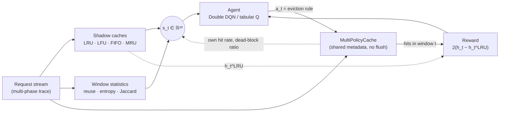
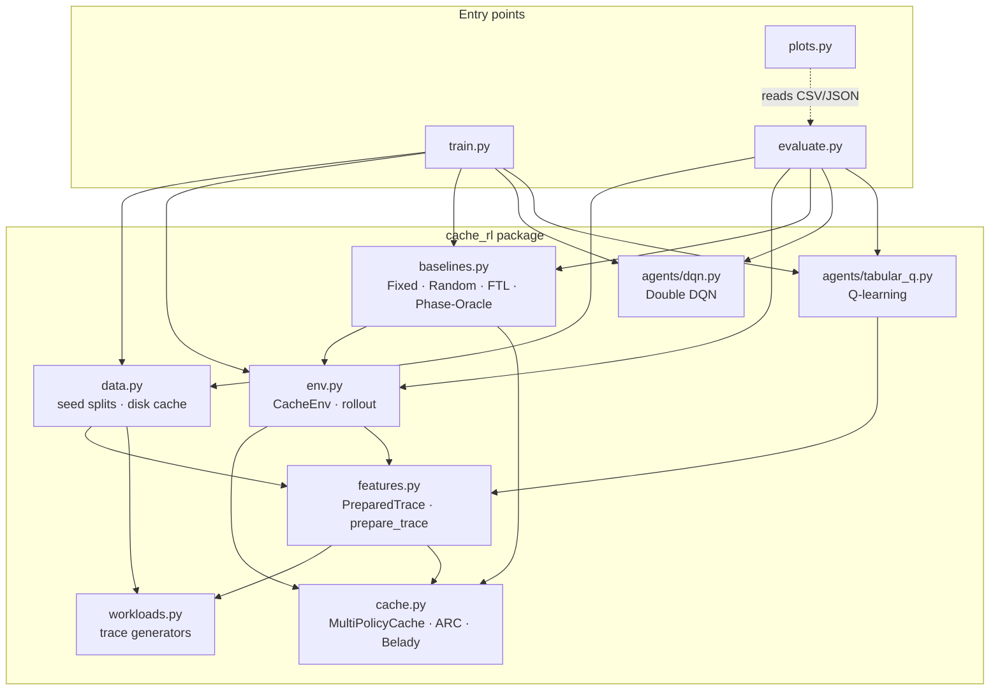
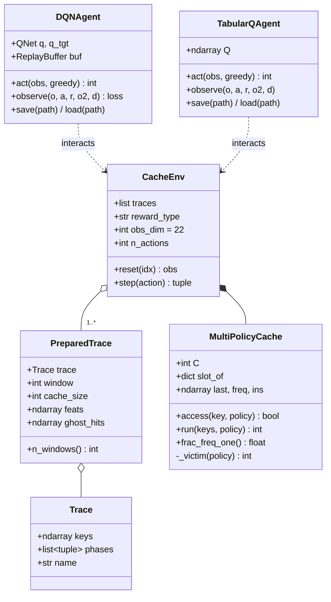
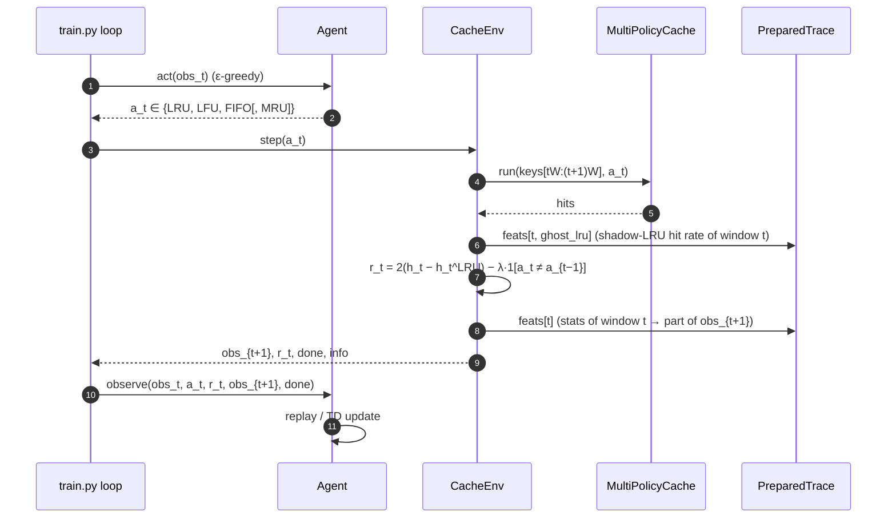
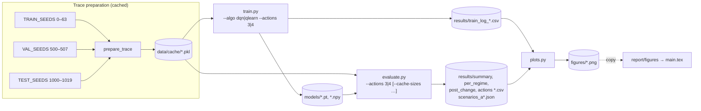

# Architecture and Developer Guide

This guide explains how the `cache_rl` package is put together, how data flows from trace generation
to the report figures, and how to extend it. For installation and the headline results see the
[README](../README.md). For known issues and planned improvements see [AUDIT.md](AUDIT.md).

- [1. System overview](#1-system-overview)
- [2. Module map](#2-module-map)
- [3. Core abstractions](#3-core-abstractions)
- [4. Control flow of one decision window](#4-control-flow-of-one-decision-window)
- [5. Observation layout](#5-observation-layout)
- [6. Experiment pipeline](#6-experiment-pipeline)
- [7. Configuration reference](#7-configuration-reference)
- [8. Outputs and file formats](#8-outputs-and-file-formats)
- [9. Extending the system](#9-extending-the-system)
- [10. Testing](#10-testing)
- [11. Performance notes](#11-performance-notes)

---

## 1. System overview

The agent does not decide which block to evict. Once per window of `W` requests (default 100), it
chooses **which classical rule** (LRU, LFU, FIFO, optionally MRU) the cache applies to every miss in
the next window. The decision is based only on statistics of past requests.



The source of this diagram, as used in the report, is
[`docs/diagrams/system_overview.mmd`](diagrams/system_overview.mmd).

## 2. Module map



| Module | Responsibility | Key symbols |
| --- | --- | --- |
| [`cache_rl/workloads.py`](../cache_rl/workloads.py) | Synthetic, non-stationary block traces made of five regimes | `Trace`, `REGIMES`, `make_trace`, `random_trace`, `SCENARIOS`, `scenario_trace` |
| [`cache_rl/cache.py`](../cache_rl/cache.py) | Cache simulators | `MultiPolicyCache`, `fixed_policy_hits`, `ARCCache`, `arc_hits`, `belady_hits` |
| [`cache_rl/features.py`](../cache_rl/features.py) | Precomputes action-independent per-window statistics | `TRACE_FEATURES`, `AGENT_FEATURES`, `OBS_DIM`, `PreparedTrace`, `prepare_trace` |
| [`cache_rl/env.py`](../cache_rl/env.py) | Gym-style episodic environment and generic rollout | `CacheEnv`, `rollout` |
| [`cache_rl/data.py`](../cache_rl/data.py) | Disjoint train/val/test seed sets, pickle cache of prepared traces | `TRAIN_SEEDS`, `VAL_SEEDS`, `TEST_SEEDS`, `build_random_set`, `build_scenarios` |
| [`cache_rl/baselines.py`](../cache_rl/baselines.py) | Non-learning comparators | `fixed`, `ftl_factory`, `phase_oracle`, `run_selector_baseline`, `run_standalone` |
| [`cache_rl/agents/dqn.py`](../cache_rl/agents/dqn.py) | Double DQN with replay buffer and Polyak target | `QNet`, `ReplayBuffer`, `DQNConfig`, `DQNAgent` |
| [`cache_rl/agents/tabular_q.py`](../cache_rl/agents/tabular_q.py) | Tabular Q-learning on a hand-discretised state | `discretise`, `n_states`, `TabularQAgent` |
| [`train.py`](../train.py) | Training CLI; keeps the best checkpoint on validation | `main`, `evaluate` |
| [`evaluate.py`](../evaluate.py) | Runs all methods on held-out traces, writes CSV/JSON | `run_all`, `summarise`, `window_regimes` |
| [`plots.py`](../plots.py) | Turns `results/` into `figures/` | `fig_*` functions |

## 3. Core abstractions



### `MultiPolicyCache`

A single array-backed cache with `C` slots. Every slot stores the metadata that all four policies
need at the same time:

| Array | Used by | Update rule |
| --- | --- | --- |
| `last[s]` | LRU (argmin), MRU (argmax), LFU decay and tie-break | set to `t` on every access |
| `ins[s]` | FIFO (argmin) | set to `t` on insertion only |
| `freq[s]` | LFU | `freq ← freq · 2^{-(t − last)/H} + 1` on a hit; `1` on insertion |

Because the metadata is always kept for every policy, switching policy only changes `_victim()`.
The cache is never flushed or rebuilt. The half-life `H` defaults to `10·C`.

### `PreparedTrace` and `prepare_trace`

Statistics that depend only on the request stream (shadow-cache hit rates, reuse intervals,
entropy, Jaccard overlap) do not depend on the agent, so they are computed **once per trace** and
stored in `feats`. Row `w` describes window `w`. The environment exposes row `w−1` when the agent
acts at window `w`, so observations are strictly causal (this is checked by `test_features_are_causal`).
`ghost_hits` holds per-request hit indicators of the four fixed-policy shadow caches; the
Phase-Oracle baseline uses them. Column 0 of `feats` (shadow-LRU hit rate) is the baseline
subtracted by the `relative` reward.

### `CacheEnv`

- `reset(idx=None)` picks a trace (at random when `idx` is `None`), resets the cache and returns
  the first observation (all trace features are zero for window 0).
- `step(a)` serves the next `W` requests with eviction rule `a` and returns
  `(obs, reward, done, info)`, where `info = {"hits", "hit_rate"}`. `done` is set when the trace
  is exhausted.
- `rollout(env, idx, selector)` runs any `obs → action` callable over one trace. It is used for
  agents and window-level baselines.

## 4. Control flow of one decision window



The three reward modes are selected with `--reward`:

| Mode | Formula | Notes |
| --- | --- | --- |
| `relative` (default) | `2·(h_t − h_t^LRU)` | Subtracts an action-independent baseline, which lowers TD-target variance |
| `hitmiss` | `2·h_t − 1` | Mean of +1 per hit and −1 per miss |
| `latency` | `−(h_t·L_hit + (1−h_t)·L_miss) / L_miss` | Normalised AMAT with `L_hit=1`, `L_miss=100` |

An optional switching penalty `switch_cost` (λ) exists in `CacheEnv` but is `0` and is not exposed on
the command line.

## 5. Observation layout

`OBS_DIM = 22` in both the 3-action and the 4-action setting. The MRU shadow cache and the fourth
previous-action slot are always present, so one network input size works for both.

| Index | Name | Meaning |
| --- | --- | --- |
| 0–3 | `ghost_lru/lfu/fifo/mru` | Hit rate of each fixed-policy shadow cache in the last window |
| 4–7 | `ghost_*_ema` | Same, exponential moving average (β = 0.8) |
| 8 | `unique_ratio` | Distinct keys / W |
| 9 | `seq_ratio` | Fraction of requests with `key_i = key_{i−1} + 1` (scan detector) |
| 10 | `new_ratio` | Fraction of first-ever references |
| 11 | `reuse_short` | Fraction of requests whose reuse interval is ≤ C |
| 12 | `reuse_mid` | Fraction with C < reuse interval ≤ 4C |
| 13 | `entropy` | Popularity entropy normalised by ln W |
| 14 | `jaccard` | Key-set overlap with the previous window (phase-change cue) |
| 15 | `own_hr` | Agent's hit rate in the last window |
| 16 | `own_hr_ema` | EMA of the agent's hit rate |
| 17 | `frac_freq1` | Fraction of resident blocks never re-referenced |
| 18–21 | `prev_LRU/LFU/FIFO/MRU` | One-hot previous action |

The tabular agent compresses this into `n_actions·3·4·n_actions·2` states (216 or 384): best shadow
policy, margin to the runner-up (bins 0.02/0.08), own-hit-rate bin (0.2/0.45/0.7), previous action,
and a Jaccard < 0.3 change flag.

## 6. Experiment pipeline



The full reproduction sequence (about 5 to 10 minutes on a laptop CPU; DQN trains at roughly 0.5 s per episode, Q-learning at 0.15 s):

```bash
python train.py --algo qlearn --actions 3 --episodes 300
python train.py --algo dqn    --actions 3 --episodes 150
python train.py --algo qlearn --actions 4 --episodes 300
python train.py --algo dqn    --actions 4 --episodes 150
python evaluate.py --actions 3
python evaluate.py --actions 4
python evaluate.py --actions 3 --cache-sizes 50 100 200
python plots.py
cp figures/*.png report/figures/
```

`evaluate.py` writes the scenario timelines (`scenarios_a*.json`) only when it is run with a single
cache size.

## 7. Configuration reference

### `train.py`

| Flag | Default | Meaning |
| --- | --- | --- |
| `--algo` | `dqn` | `dqn` or `qlearn` |
| `--episodes` | `300` | Training episodes (one episode is one random 6-phase trace) |
| `--cache-size` | `100` | Cache capacity C |
| `--window` | `100` | Requests per decision W |
| `--reward` | `relative` | `relative`, `hitmiss`, or `latency` |
| `--actions` | `3` | `3` = {LRU, LFU, FIFO}; `4` adds MRU |
| `--eval-every` | `20` | Episodes between greedy validation runs |
| `--seed` | `0` | Agent and environment seed |
| `--out` / `--log` | `models` / `results` | Output directories |

### `evaluate.py`

| Flag | Default | Meaning |
| --- | --- | --- |
| `--cache-sizes` | `100` | One or more capacities; more than one writes `*_sizes.csv` |
| `--window` | `100` | Requests per decision |
| `--actions` | `3` | Which agents and baselines to load and run |
| `--models` / `--out` | `models` / `results` | Input and output directories |

### Hyper-parameters set in code

| Component | Parameter | Value | Location |
| --- | --- | --- | --- |
| DQN | γ, lr, batch, buffer, warm-up | 0.9, 5e-4, 128, 50 000, 1 000 | `DQNConfig` |
| DQN | τ (Polyak), hidden, reward scale | 0.01, 128, 10 | `DQNConfig` |
| Both | ε schedule | 1.0 → 0.03 linear over 60% of steps | `train.py` |
| Q-learning | α, γ, reward scale | 0.1, 0.9, 10 | `TabularQAgent` |
| Cache | LFU half-life H | 10·C | `MultiPolicyCache` |
| Features | EMA β | 0.8 | `prepare_trace`, `CacheEnv` |
| Data | feature-cache version | `v2` | `data.FEATURE_VERSION` |

## 8. Outputs and file formats

| File | Columns / content |
| --- | --- |
| `results/train_log_{algo}_a{n}.csv` | `episode, steps, epsilon, train_hit_rate, return, val_hit_rate` (validation is blank between evaluations) |
| `results/summary_a{n}[_sizes].csv` | `method, cache_size, hit_rate, hit_rate_std, amat, post_change_hit_rate` |
| `results/per_regime_a{n}[_sizes].csv` | `method, regime, cache_size, hit_rate` |
| `results/post_change_a{n}[_sizes].csv` | `method, cache_size, window_after_change (1–10), hit_rate` |
| `results/actions_a{n}[_sizes].csv` | `method, regime, cache_size, LRU, LFU, FIFO, MRU` (fraction of windows) |
| `results/scenarios_a{n}.json` | `{scenario: {window, phases, methods: {name: {hit_rate[], actions[]}}}}` |
| `models/dqn_a{n}.pt` | `{"state_dict", "cfg"}` for `QNet` |
| `models/qlearn_a{n}.npy` | Q-table of shape `(n_states, n_actions)` |

## 9. Extending the system

**Add a workload regime.** Write `gen_<name>(rng, n, cache_size) -> ndarray` in `workloads.py`,
register it in `GENERATORS` and `REGIMES`, and bump `data.FEATURE_VERSION` so cached pickles are
rebuilt.

**Add an eviction policy (action).** Add a constant in `cache.py` and a branch in
`MultiPolicyCache._victim`. Add it to `features.GHOST_POLICIES` and `TRACE_FEATURES` if the agent
should see its shadow hit rate. Widen `env.N_PREV`, the `n_actions` assertion in `CacheEnv`, the
`--actions` choices, and the name lists in `baselines.window_selector_names` and `plots.py`.
`OBS_DIM` changes, so existing checkpoints become incompatible.

**Add an observation feature.** Agent-independent features go into `TRACE_FEATURES` and the `F[w]`
row in `prepare_trace`. Agent-dependent ones go into `AGENT_FEATURES` and `CacheEnv._obs`. If the
new feature is inserted before them, update the hard-coded indices in `agents/tabular_q.py`. Bump
`FEATURE_VERSION`.

**Add a learning algorithm.** Implement the duck-typed agent interface used by `train.py`:
`act(obs, greedy=False) -> int`, `observe(o, a, r, o2, done)`, `epsilon()`, `steps`, `save(path)`,
and a `load` classmethod. Register it in `train.py` and `evaluate.load_agents`.

**Add a baseline.** Window-level selectors are plain `obs -> action` callables; add a name to
`window_selector_names` and a branch in `run_selector_baseline`. Per-request algorithms go in
`cache.py` with a `*_hits(keys, capacity)` function and a branch in `run_standalone`.

## 10. Testing

```bash
python -m unittest discover -s tests -v
```

| Test | What it guarantees |
| --- | --- |
| `TestWorkloads` | Every regime generates the requested length, and phase metadata is correct |
| `test_multipolicy_hits`, `test_arc_hits` | Simulators run and return well-formed output |
| `test_arc_invariants` | ARC list-size invariants from Megiddo & Modha hold on random traces |
| `test_belady_hits`, `test_belady_is_optimal` | Belady ≥ LRU, and Belady equals exhaustive search on tiny traces |
| `test_feature_dimensions`, `test_env_*` | Observation shape is `OBS_DIM` for both action sets |
| `test_features_are_causal` | Changing future requests never changes past-window features (no look-ahead) |
| `TestAgents` | Both agents act, learn one step, and load saved checkpoints |

## 11. Performance notes

- Trace preparation dominates start-up: four full shadow-cache simulations per trace in pure
  Python. Results are pickled under `data/cache/` (git-ignored) and keyed by
  `FEATURE_VERSION`, cache size, window, and seed range.
- `MultiPolicyCache._victim` is an O(C) `argmin` per miss. That is fine for C ≤ a few hundred. A
  heap or linked list per policy would be needed for large caches.
- `torch.set_num_threads(2)` in `train.py` avoids thread overhead for the small MLP.
- Evaluating all methods on 20 test traces takes about 25 s per action setting on a laptop CPU.
